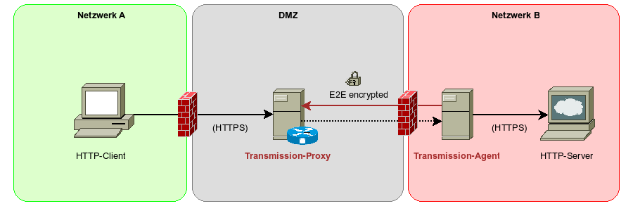
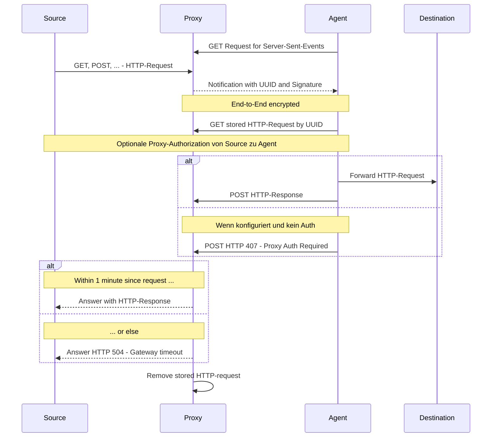

# Transmission

Transmission ist ein im Aufbau befindliches System eines Proxys/Request-Brokers zur Kommunikation in getrennten
Netzwerkumgebungen.
Requests werden transparent an das Zielsystem Ende-zu-Ende-verschlüsselt und signiert weitergeleitet.
Anfragen werden ähnlich einem Proxy entgegengenommen und Antworten entsprechend zurückgereicht.

## Aufbau

Das System besteht aus zwei Teilen. Einer Anwendung, welche Anfragen ähnlich einem HTTP-Proxy entgegennimmt und
einer (oder mehrerer) Agent-Anwendung (en), die im Zielnetzwerk Anfragen abruft, weiterleitet und die Antwort
zurücksendet.



## Konfiguration

Eine typische Konfiguration für den Proxy sieht wie folgt aus. Es sind mehrere Agents für jeweils ein Zielsystem
erlaubt.

```toml
[proxy]
listen = "[::]:3000"
public_key = "WsGhvSpDWze5X4Snasu6HG6dpMiiSjHrgGwg4aVjjlQ="
private_key = "LGS+U6Lah3MfXNeMfqVwaH9+RPtD2Uq9dA22IcA+YN4="

# Multiple agents allowed for different destinations
[[peers]]
destination = "www.example.com"
public_key = "xXpx/tsFgrNq9ukGvSGZfD7LsFwiLe5lrM7ufJPCz00="
shared_secret = "test-www.example.com"
```

Ein Agent kann wie folgt konfiguriert werden. Hier lässt sich auch die erlaubten Request-Methoden konfigurieren.

```toml
[agent]
allowed_methods = ["GET"]
public_key = "xXpx/tsFgrNq9ukGvSGZfD7LsFwiLe5lrM7ufJPCz00="
private_key = "Ak2+Ye6mEsefdVfcr4zvyXyiGI7L+4bx4zV7XeM3Bgk="
# Optional Proxy authorization to be sent by client
proxy_authorization = "tester:$2b$12$D1NYodlxv3HdTbQtEzqltugICqSy08qNLlBsVIX/62KGCWFBmso/q"

[peer]
url = "http://localhost:3000"
public_key = "WsGhvSpDWze5X4Snasu6HG6dpMiiSjHrgGwg4aVjjlQ="
shared_secret = "test-www.example.com"

[destination]
name = "www.example.com"
base_url = "https://www.example.com"
```

### Schlüssel

Schlüssel können mit den Utils erstellt werden.

#### Geheimer Schlüssel

```bash
transmission-utils genkey
```

Mit der Option `-v` wird das Schlüsselpaar zusammen ausgegeben:

```angular2html
$ transmission-utils genkey -v
Public key:  rqzIRrUfzI2u7hdm3pcAmBAvklWF5qwq/CTTcKncbjs=
Private key: 6Vp9tsRFVIgBm/uBQg/vbuVm9C/rQYCqe2M3zz7d32A=
```

#### Öffentlicher Schlüssel

Zum Ableiten des öffentlichen Schlüssels aus dem geheimen Schlüssel:

```bash
echo "<geheimer Schlüssel>" | transmission-utils pubkey
```

#### Proxy-Authorization

Hier für Benutzer "tester":

```bash
transmission-utils proxy-auth tester
```

Benutzername und Password wird vom Agent ausgewertet.

## Ende-zu-Ende Verschlüsselung

Alle Requests und Antworten werden symmetrisch mit dem AEAD-Algorithmus (Authenticated Encryption with Authenticated
Data) „ChaCha20Poly1305“ verschlüsselt.
Dadurch wird sichergestellt, dass nur die vorgesehenen Empfänger den Text entschlüsseln können.

Der symmetrische Schlüssel wird über einen Diffie-Hellman-Schlüsseltausch, basierend auf X25519 Schlüsselpaaren
erstellt.
Dadurch ist sichergestellt, dass muss nur der jeweils öffentliche Teil des Schlüsselpaars dem Kommunikationspartner
(Proxy/Agent) bekannt sein muss.

Zudem wird in jeder Signalisierung eine HMAC-SHA256-Signatur eingebettet und nicht korrekt signierte Anfragen vom
zugehörigen Agent verworfen.

## Proxy Authorization

Wenn erforderlich, kann für einen Agent ein Benutzername und ein Passwort konfiguriert werden.
Anfragen werden dann zwar zum Agent weitergeleitet, jedoch bei fehlenden oder ungültigem Passwort
mit `HTTP 407 - Proxy Authorization Required` abgewiesen.

Ein Client muss in diesem Fall den HTTP-Header
[`Proxy-Authenticate`](https://developer.mozilla.org/en-US/docs/Web/HTTP/Reference/Headers/Proxy-Authenticate)
verwenden.
Dieser wird nicht an das eigentliche Ziel weitergeleitet.

So ist es möglich, direkt auf Ebene des Zielsystems den Zugriff zu beschränken.

## Ablauf eines Requests

Die Anwendung agiert als HTTP-Proxy.
Wenn der Client oder das System zur Nutzung eines Proxys konfiguriert wurde,
dann kann der Request direkt mit dem Ziel als Host versendet werden:

```bash
curl -v http://www.example.com
```

Eine Anfrage kann auch direkt an den Proxy gerichtet werden und benötigt die Kennung des Ziel-Agents:

```bash
curl -v http://localhost:3000/_proxy/www.example.com
```

### Verwendung eines vorgelagerten Reverse-Proxys

Befindet sich die Proxy-Anwendung z.B. hinter einem Reverse-Proxy (wie z.B. Traefik) mit SSL-Terminierung,
kann auch eine SSL-gesicherte Verbindung aufgebaut werden.

Hierzu muss vonseiten des Agents die Möglichkeit bestehen, den Proxy mit den Pfaden `/_events` und `/_pending`
zu erreichen.

Clients müssen, je nach Einsatzzweck, die Pfade `/` oder bei Bedarf `/_proxy` erreichen können.



Agents bauen eine HTTP-Verbindung zum Proxy auf und warten auf eine Signalisierung in Form von Server-Sent-Events.
Trifft ein Event ein, wird der verschlüsselte Request abgerufen, entschlüsselt und an das Zielsystem weitergeleitet.
Im Anschluss wird dem Proxy die Antwort des Zielsystems inklusive HTTP-Header übermittelt, dort an das Quellsystem
weitergeleitet und die Anfrage im Proxy gelöscht.

Wird eine Anfrage nicht innerhalb einer Minute beantwortet wird dem Quellsystem mit `HTTP 504 - Gateway timeout` die
Nichterreichbarkeit signalisiert. Auch dies führt zum Löschen der wartenden Anfrage im Proxy.

Anfragen aus abgebrochenen Verbindungen werden minütlich ermittelt und ebenfalls entfernt.
