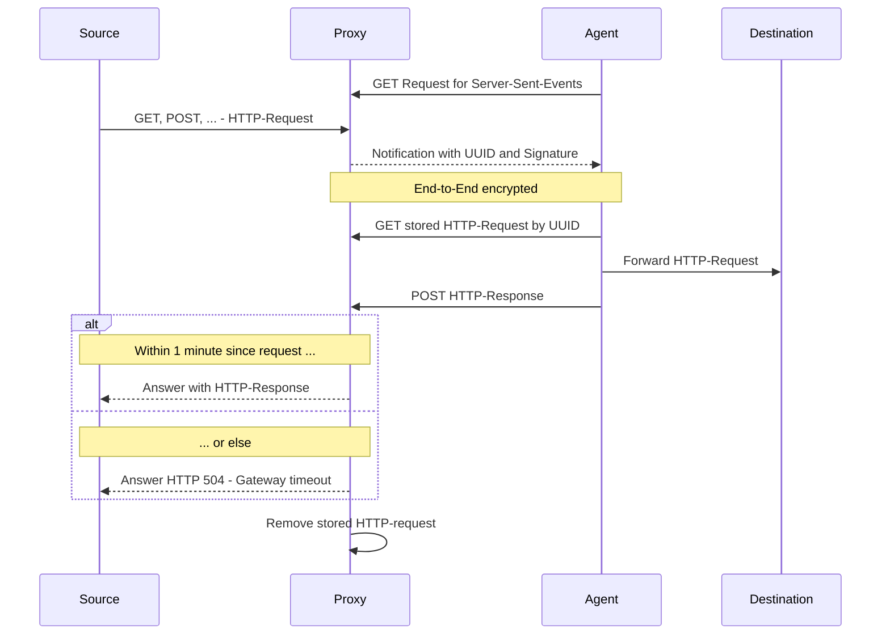

# Transmission

Transmission ist ein im Aufbau befindliches System eines Proxys/Request-Brokers zur Kommunikation in getrennten
Netzwerkumgebungen.
Requests werden transparent an das Zielsystem Ende-zu-Ende-verschlüsselt und signiert weitergeleitet.
Anfragen werden ähnlich einem Proxy entgegengenommen und Antworten entsprechend zurückgereicht.

## Aufbau

Das System besteht aus zwei Teilen. Einer Anwendung, welche Anfragen ähnlich einem HTTP-Proxy entgegennimmt und
einer (oder mehrerer) Agent-Anwendung (en), die im Zielnetzwerk Anfragen abruft, weiterleitet und die Antwort
zurücksendet.

## Konfiguration

Eine typische Konfiguration für den Proxy sieht wie folgt aus. Es sind mehrere Agents für jeweils ein Zielsystem
erlaubt.

```toml
[proxy]
listen = "[::]:3000"
public_key = "WsGhvSpDWze5X4Snasu6HG6dpMiiSjHrgGwg4aVjjlQ"
private_key = "LGS+U6Lah3MfXNeMfqVwaH9+RPtD2Uq9dA22IcA+YN4"

# Multiple agents allowed for different destinations
[[peers]]
destination = "www.example.com"
public_key = "xXpx/tsFgrNq9ukGvSGZfD7LsFwiLe5lrM7ufJPCz00"
shared_secret = "test-www.example.com"
```

Ein Agent kann wie folgt konfiguriert werden. Hier lässt sich auch die erlaubten Request-Methoden konfigurieren.

```toml
[agent]
allowed_methods = ["GET"]
public_key = "xXpx/tsFgrNq9ukGvSGZfD7LsFwiLe5lrM7ufJPCz00"
private_key = "Ak2+Ye6mEsefdVfcr4zvyXyiGI7L+4bx4zV7XeM3Bgk"

[peer]
url = "http://localhost:3000"
public_key = "WsGhvSpDWze5X4Snasu6HG6dpMiiSjHrgGwg4aVjjlQ"
shared_secret = "test-www.example.com"

[destination]
name = "www.example.com"
base_url = "https://www.example.com"
```

## Ende-zu-Ende Verschlüsselung

Alle Requests und Antworten werden symmetrisch mit dem AEAD-Algorithmus (Authenticated Encryption with Authenticated
Data) „ChaCha20Poly1305“ verschlüsselt.
Dadurch wird sichergestellt, dass nur die vorgesehenen Empfänger den Text entschlüsseln können.

Der symmetrische Schlüssel wird über einen Diffie-Hellman-Schlüsseltausch, basierend auf X25519 Schlüsselpaaren
erstellt.
Dadurch ist sichergestellt, dass muss nur der jeweils öffentliche Teil des Schlüsselpaars dem Kommunikationspartner
(Proxy/Agent) bekannt sein muss.

Zudem wird in jeder Signalisierung eine HMAC-SHA256-Signatur eingebettet und nicht korrekt signierte Anfragen vom
zugehörigen Agent verworfen.

## Ablauf eines Requests

Eine Anfrage erfolgt immer über den Proxy und benötigt die Kennung des Ziel-Agents:

```bash
curl -v http://localhost:3000/proxy/www.example.com
```



Agents bauen eine HTTP-Verbindung zum Proxy auf und warten auf eine Signalisierung in Form von Server-Sent-Events.
Trifft ein Event ein, wird der verschlüsselte Request abgerufen, entschlüsselt und an das Zielsystem weitergeleitet.
Im Anschluss wird dem Proxy die Antwort des Zielsystems inklusive HTTP-Header übermittelt, dort an das Quellsystem
weitergeleitet und die Anfrage im Proxy gelöscht.

Wird eine Anfrage nicht innerhalb einer Minute beantwortet wird dem Quellsystem mit `HTTP 504 - Gateway timeout` die
Nichterreichbarkeit signalisiert. Auch dies führt zum Löschen der wartenden Anfrage im Proxy.

Anfragen aus abgebrochenen Verbindungen werden minütlich ermittelt und ebenfalls entfernt.
